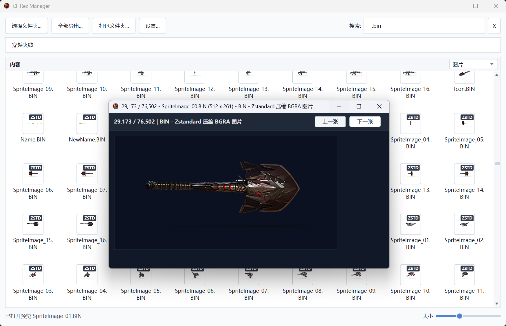
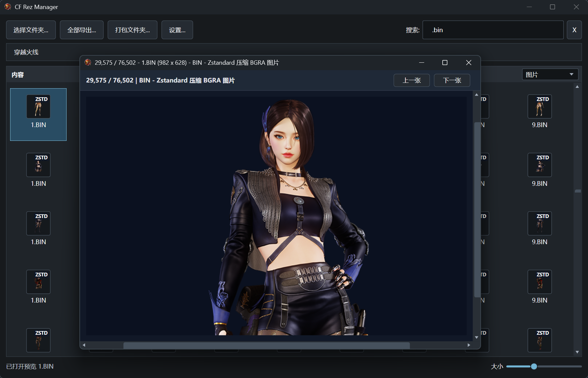
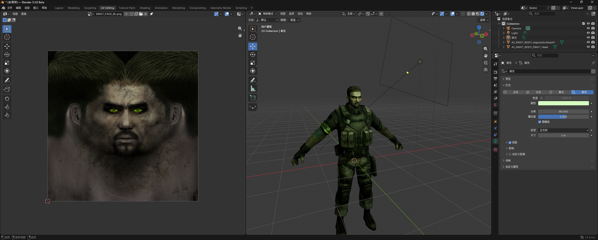
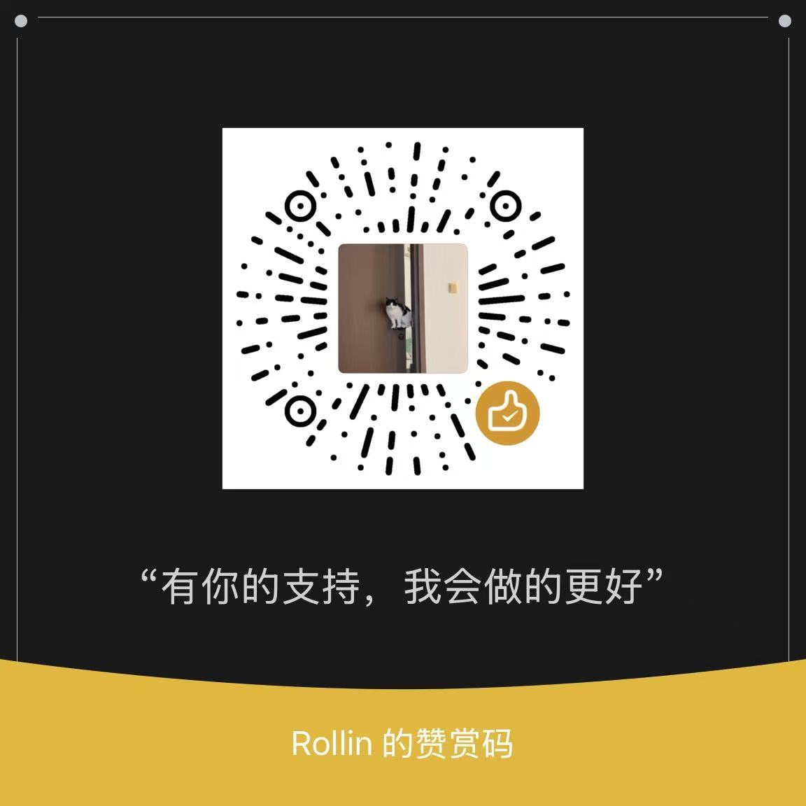

# CF Rez Manager

中文点这里 [README.md](README.md).





CF Rez Manager is a Windows WPF tool for browsing, searching, previewing, extracting, and packing LithTech / CrossFire `.rez` archives. It can also inspect loose resource files from extracted folders.

## What It Does

- Browse `.rez` archives, internal REZ folders, and normal resource folders.
- Search files, folders, and internal REZ paths with multi-keyword filtering.
- Export all resources, or only selected files, folders, and REZ entries.
- Pack a normal Windows folder into a new `.rez` archive.
- Preview images, textures, audio, models, maps, script configs, and common CrossFire/LithTech resources.
- Choose per format whether decodable image resources such as BIN, DTX, TGA, and DDS are exported as source files or standard `.png` files.
- Provide command-line batch entry points for OBJ/MTL model export, CFG scanning, and CFG decoding.

## Requirements

- Windows
- .NET 8 SDK or .NET 8 Runtime

## Build And Run

```powershell
dotnet build .\CFRezManager.csproj
```

Run the app from Visual Studio, or start the built executable:

```text
bin\Debug\net8.0-windows7.0\CFRezManager.exe
```

## Project Structure

```text
CFRezManager/
|-- App.xaml
|-- App/
|-- Archives/
|-- Commands/
|-- Decoders/
|   |-- Audio/
|   |-- Compression/
|   |-- Config/
|   |-- CrossFire/
|   |-- Fmod/
|   |-- Images/
|   |-- LithTech/
|   |   `-- Models/
|   `-- Text/
|-- Explorer/
|-- Preview/
|   |-- Audio/
|   |-- Image/
|   |-- Model/
|   `-- Text/
|-- UI/
|-- assets/
|-- CFRezManager.csproj
`-- CFRezManager.sln
```

- `App/`: startup helpers, settings, localization, and assembly metadata.
- `Archives/`: REZ reading, writing, and directory-table encryption logic.
- `Commands/`: command-line entry points for OBJ export, CFG scan/decode, and standalone preview.
- `Decoders/`: resource decoders grouped by audio, images, CrossFire, LithTech, text, and related formats.
- `Explorer/`: resource browser item model and thumbnail cache.
- `Preview/`: standalone preview windows for audio, images, models, and text.
- `UI/`: main window and UI controls.
- `assets/`: app icon and image resources copied with the app.

## Basic Use

1. Start the program.
2. Select a folder that contains `.rez` files or loose resources.
3. Double-click a folder, REZ archive, internal REZ folder, or supported preview file.
4. Use the breadcrumb bar to move back or jump to a parent location.

Click `Settings...` in the top toolbar to open the settings window, where you can switch between `Chinese` / `English`, `Light` / `Dark` themes, configure image export formats, and clear the thumbnail cache. The app remembers language, theme, view size, scan folder, pack folder, extract folder, save location, and image export options.

The search box builds an in-memory index the first time you type, then quickly filters scanned files, folders, and internal REZ paths. Separate keywords with spaces to require all terms to match.

Use the bottom-right `Size` slider to switch between list view and tiled icon view. Hover an item to see type, path, size, source, MD5, offset, and related metadata.

Common right-click actions:

- `Locate File`: jump from search results to the containing folder and select the file.
- `Copy Name`: copy one or more selected item names.
- `Extract This Item...` / `Extract N Selected Items...`: export selected files, folders, or REZ entries.
- `Decode BANK...`: export a decoded bank and raw FSB5 audio blocks.

## Preview Support

- Images and textures: PNG, JPG, BMP, GIF, TIFF, DDS, TGA, DTX, CrossFire image BIN, original-size preview, and previous/next navigation.
- Compressed resources: common LZMA-wrapped resources, with thumbnail badges such as `RAW`, `LZMA`, `DXT`, and `TXT`.
- Audio: WAV, OGG, MP3, and FMOD `.bank`, with waveform thumbnails, track list, playback controls, seeking, and dynamic spectrum display. OGG/MP3 previews decode to PCM before spectrum rendering so normal audio files behave more like FMOD BANK streams.
- Models and maps: LTC, LTB, LTA, DAT, and SPR, with thumbnails and standalone preview windows; SPR can autoplay animation frames.
- Text and config resources: CFT, FCF, FXF, FXO, NAV, APF, REF, TXT, selected WAVE resources, CrossFire UI script `.bin`, and CFG.
- CFG batch work: scan texture references, decode plain/LZMA/ENC/REZ-phase text CFG files, classify failed decodes, and render previews for binary RGB-strip CFG files.

Generated thumbnails are cached in the `ThumbnailCache` folder under the program directory instead of the current Windows user profile disk. On startup, the app tries to remove the old user-profile thumbnail cache; use `Clear Cache` in `Settings` after replacing resources to remove current stale thumbnails.

## Model Preview Controls

- Left-click the model viewport: enter free-look mode.
- Move the mouse: adjust the view direction.
- `W` / `A` / `S` / `D`: move forward, left, backward, and right.
- `Shift`: move faster.
- Mouse wheel: move forward or backward along the current view direction.
- Right-click or `Esc`: leave free-look mode.
- `Reset View`: reset the camera position and direction.

## Extract Resources

Use `Extract All...` to export every file from all REZ archives in the scanned folder.

To export selected items:

1. Select a file, folder, REZ archive, or internal REZ folder.
2. Hold `Ctrl` or `Shift` when selecting multiple items.
3. Right-click the selection.
4. Choose `Extract This Item...` or `Extract N Selected Items...`.
5. In the export format window, choose for BIN, DTX, TGA, and DDS whether to keep the source file or export a decoded PNG.
6. Select an output folder.

Export format choices are saved automatically. If you enable `Do not show this window on future exports`, later exports use the saved options directly; reopen `Settings` -> `Export Format Settings...` to change them. Exported files keep their internal REZ folder structure; BIN files that are not images, such as scripts or configuration tables, and files that fail to decode keep their original extension and source data.

## Pack Into REZ

Use `Pack Folder...` to create a new `.rez` archive from a normal Windows folder.

1. Prepare a folder containing the files and subfolders you want.
2. Click `Pack Folder...`.
3. Select the source folder.
4. Choose the output `.rez` path.

Notes:

- File data is stored directly in the archive.
- REZ directory tables are encrypted, and file MD5 values are recalculated.
- File and folder names currently must be ASCII.
- File extensions must be 1 to 4 characters long.
- A newly packed REZ preserves content and folder structure, but does not copy the original archive's exact byte layout, offsets, timestamps, or whole-file MD5.

## Command-Line Tools

Directory browsing and export scans list only files with a valid REZ header. `.REZ` data shards beside an archive remain available to the reader through that archive's index and are not treated as separate archives.

```powershell
dotnet run --project .\CFRezManager.csproj -- --export-obj --root "F:\Game\CrossFire" --model "PV-AK47_Balance" --output ".\out\PV-AK47_Balance.obj"
dotnet run --project .\CFRezManager.csproj -- --audit-texture-map --root "F:\Game\CrossFire" --output ".\out\crossfire_texture_mapping_audit.tsv"
dotnet run --project .\CFRezManager.csproj -- --audit-table-decode --root "F:\Game\CrossFire" --output ".\out\table_decode.tsv"
dotnet run --project .\CFRezManager.csproj -- --inspect-ltb-header --root "F:\Game\CrossFire" --model "Models/CHARACTER/NINJATRANSLUCENT"
dotnet run --project .\CFRezManager.csproj -- --inspect-ltb-header --root "F:\Game\CrossFire" --all-renderstyles
dotnet run --project .\CFRezManager.csproj -- --scan-cfg --root "C:\Extracted\cfg"
dotnet run --project .\CFRezManager.csproj -- --decode-cfg --root "C:\Extracted\cfg"
```

- DTX files under `TEX/` resolve by full path or directory suffix; they are excluded from filename-only candidates. Slot 2 on `PV-ShieldCard_AI_NEW`, `_BL`, `_GR`, `_WOMAN_BL` and `_WOMAN_GR` is verified against `TEX/UI/AIMode/AI1PreCrater/CARD.DTX`. The base and `_BL` models use the `card` mesh; the other variants use `Box003`. Every physical model copy must share the same card-slot UV-triangle signature, and all DTX copies must decode with identical SHA-256. The export reports `variant-slot-uv-derived`.
- `--export-obj`: export LithTech models to OBJ/MTL, write a sibling `_textures` folder, and reference exported PNG textures from the MTL. The `_texture_slots.tsv` report records each local material stage, global skin slot, context-resolved texture path, and whether it is `unresolved`, `export-failed`, or `exported`. UCC object models bind a mesh to a unique same-name `UCC/ModelAssets/UCC_Textures/Object/*.DTX`; `UCC_Model` assets continue to use their dedicated model-texture index. The report inventories engine multi-stage slots, but OBJ/MTL still displays only one diffuse texture and does not represent a complete RenderStyle reconstruction. Meshes skipped for non-finite geometry are listed separately.
- `--audit-texture-map`: scan the resource directory and REZ archives and write global-slot, contextual-slot, inferred-slot, per-mesh, and LTB inventory rows. `mesh-export` records the first candidate in export order that the actual texture resolver can decode; `mesh-semantic` disables the global-config fallback and keeps only slot, mesh, and path-semantic candidates. A decodable texture is not proof that it is the game's final skin. The TSV flags ambiguity, physical-copy conflicts, missing textures, model decode failures, and rows with no resolver evidence. Physical-copy conflict rows include each model copy's archive, resource path, MD5, and per-copy texture candidates. `candidate-resource-present-unresolved` means a candidate resource exists inside the model-texture path scope but the resolver returned no image; `candidate-resource-present-unresolved-outside-model-texture-scope` means the resource is outside that scope and the resolver also returned no image. Details mark `image_decode=unconfirmed`, so a path lookup miss is not mislabeled as an image decode failure. `texture-path-decode-probe` directly decodes every physical copy at the exact path for mesh candidates and unresolved direct slot references, and records the decodable-copy count, whether all copies failed, or whether the exact path is absent. Texture-name fallbacks apply only when the candidate path is unique; the missing PV-QBZ95_Silencer_Volcano player-view texture uses PV-QBZ95_Volcano, whose model geometry and UVs match exactly. Root-level `ModelTextures/` and `UCC/ModelAssets/UCC_Textures/` are included in model-texture path recognition. Non-geometry LTB resources such as RenderStyles are listed separately and excluded from model decode failures; unevidenced rows are not treated as resolved.
- AI1_EvilDen CutScene02 Dark/Fire models and their motion copies bind slot 4 to `AI_Stone.dtx` only when every model copy decodes the complete single-slot UV layouts for `stone01/02/03` and all physical copies of the exact DTX have matching hashes; those UVs land on the stone-gate atlas. The `Uma` mesh remains unresolved: its UV triangles have no exact match in either the `AI_Umaking` or `AI_GhostUmaking` body mesh, and nearby CFT rows alone do not establish which skin the cutscene uses.
- Native LTB decoding preserves model-data UV sets 1–4 by channel and records each source stream. A channel duplicated with conflicting values across streams is marked unavailable. `mesh-render-stage` details include `uv_source_name`, zero-based `uv_set_index`, the available-channel count `mesh_uv_set_count`, the requested channel's `uv_source_stream_index`, and `uv_data_status`. When the texture binding and resource are valid but the requested model UV set is missing or conflicting, the stage status is `renderstyle-stage-uv-set-unavailable`; unknown UV sources are marked `renderstyle-stage-uv-source-unsupported`. The OBJ `_texture_slots.tsv` records each mesh's available UV-channel count and the UV1 source stream. OBJ export still writes UV set 1 and one diffuse map, so it cannot display stages that use UV sets 2–4.
- `--probe-texture-map-paths --audit <audit.tsv>`: directly decode every unique texture path referenced by `model`, `context`, `mesh-slot`, and `mesh-render-stage` rows in an existing audit, testing each physical copy. The separate TSV distinguishes all-copy success, partial-copy failures, all-copy failures, and exact paths that are absent. Missing paths also list filename-near resource paths as investigation leads; they are never substituted automatically. Pass `--root` and `--output` as well.
- `--inspect-ltc-motion-links`: scan decodable LTC contents and report motion-model fields alongside ordinary model, texture, and identity fields from the same row. The main audit binds a same-row `MotionFileName` to `SkinFileName` while preserving row identity context; it does not infer links absent from the table.
- `--inspect-cft-motion-links`: report parent models, motion models, texture fields, and identity fields that occur together in a typed CFT record, for verifying direct support for motion-model slot inheritance.
- `--audit-table-decode`: read every physical CFT/LTC copy in the directory and its REZ archives, including root-level `engine.rez`, without skipping copies based on archive MD5 metadata. The TSV records actual SHA-256 content hashes, decoded bytes, CFT row/column counts, consumed bytes, and uninterpreted trailing bytes. Read errors, size limits, and directory/archive scan failures are reported separately. CFT `typed-decoded` means all declared rows and any recognized ASCII `END` footer have been consumed; `typed-decoded-with-trailing-bytes` retains unexplained data. LTC `native-text-decoded` means an in-process path recovered text; configuration LTC files need not contain model geometry. A sibling `_summary.txt` reports physical-copy and unique-content counts. Successful decoding does not establish model/texture mapping correctness.
- `--inspect-cft-model-texture-links`: report model fields, related models, texture fields, and identity aliases from every typed CFT row to distinguish character, motion, arm, and socket references.
- `WeaponAttachItemDoll.CFT` item identities can also bind preview accessory textures: `item:13869` (row 147) and `item:21765` (row 320) both map `Box002` on `PV-ACC_Interaction_Joy` slot 0 to `PV-ACC_Baihu.dtx`. Focused exports for both report `context-slot` with no missing textures.
- The `Blitz_Buster_Hair_SP` entry in `CharacterItem.CFT` row 1809 remaps the missing `Blitz_Buster_HAT_SP.dtx` references in `_BLTexFile2` / `_GRTexFile2` to native slot 0. This applies only when every model copy decodes to the same single-mesh slot layout with mesh name `V214_Blitz_Buster_GR_hiar`, and every copy of the unique `Blitz_Buster_HAIR_SP.DTX` decodes with the same SHA-256. Focused exports with and without the identity context each export one texture with zero missing.
- Row 320 also carries the identity alias `ACC_Interaction_BlueLotus` for the separate `PV-ACC_Interaction_BlueLotus` model. The Baihu texture is inferred into that row's context only when the alias uniquely names a same-directory ACC_SD preview model, every Joy and target copy has identical mesh layout, UVs, slots, RenderStyle and authoritative bindings, every copy of the exact DTX decodes with matching SHA-256, and the target slot has no direct or conflicting mapping. The focused `item:21765` export resolves slot 0 on both Joy and BlueLotus `Box002` meshes to `PV-ACC_Baihu.dtx`; BlueLotus is reported as `cft-identity-model-alias-derived`. This inference is context-only.
- Both CFT reference diagnostics count a document as decoded only after reading all declared rows. References extracted from partial tables remain in the reports; use `--audit-table-decode` to inspect per-file failures and trailing bytes.
- When all declared rows decode and a standard `END` footer immediately follows them, CFT path-candidate scanning stops before that footer, preventing residual data from contaminating another model's texture candidates. The decode audit still reports bytes after the footer as uninterpreted. Tables without complete row/footer evidence retain the existing partial extraction path.
- The 2026-10-23 full decode audit found post-`END` data in 70 unique CFT contents. Only the tail of `KingsMissionObjectInfo.CFT` contained recognizable model or texture paths. The 449-byte tail of `CharacterType.CFT` contained no paths, and post-footer data is not used for row-level mappings.
- `--inspect-ltc-model-texture-links`: report typed LTC model rows, texture fields, auxiliary texture references, and identity aliases for weapon and player-view model mapping.
- `--inspect-texture-resource-paths --contains <text>`: list matching logical texture paths, physical copies, and MD5 values to check for conflicting same-name DTX files.
- Extensionless CFT motion references are accepted only when the full logical path resolves to one resource extension, both models decode, and their actual texture-slot intersection is non-empty.
- Motion textures inherit only from the primary model field in the same typed record; Socket, hand/arm, player-view, weapon, and projectile fields are not carried to a motion model.
- An unnumbered `SkinFileName` is carried to motion slot 0 only when every physical parent and child copy decodes with slot 0 and the texture exactly matches an existing direct slot-0 mapping on the parent. Other skin fields still require explicit slot indices.
- The missing `AI_PrincessIron_HAIR.dtx` reference resolves to the unique `PrincessIron_PC_HAIR.dtx` resource only for the `AI_Boss_PrincessIron` parent, its linked motion model, and slot 2. The motion hair mesh shares 1,607/1,663 UV triangles with the CFT-bound `PrincessIron_PC_Hair` model.
- An unnumbered `ModelTexFileName` in `Parts.CFT` binds only when every physical model copy decodes and uses the same single material slot. The texture follows the exact CFT path; context mappings also require identical MD5 hashes across DTX copies.
- EvilDen CutScene02 Dark/Fire parent and motion models map slots 0/1/2 to Map01/02/03 only when every physical copy matches the CFT-bound socket/parent donor by dragon mesh name, UV-triangle layout, declared slot, and RenderStyle, and all DTX copies share one MD5. The Uma and stone slots do not inherit these textures.
- `--inspect-ltb-header`: list matching LTB copies, show stored/decompressed headers and file type, retry geometry decoding for models, and decode D3D RenderStyles while reporting style/pass counts. Use `--all-renderstyles` to inspect and decode all recognized RenderStyle paths/names in one pass.
- `--texture-context` accepts a character or item ID/name. Character hand/arm textures come from CFT; first-person item textures come from LTC and map to slots present in the LTB. When a same-group `WeaponModel` row uniquely links an item, `item:<item-id>` follows `WeaponPreview` → `WeaponModel` to an LTC `WeaponIndex` or a conflict-free legacy weapon-binding ordinal reconstructed with the prior deduplication rule. If the numeric ID overlaps another LTC `WeaponIndex`, use `preview:<model-group-id>:<item-id>` to select the preview-table link without confusing the two ID domains. When no usable `WeaponModel.ModelId` exists for that item/group, the resolver can fall back to the same-ID LTC `WeaponIndex`; it skips this only when another group has a directly matched LTC `WeaponIndex` target. Bindings stay scoped to their model and texture fields. A legacy LTC path is linked to a physical resource only when row type, role field, model/texture filenames, identity alias, and target LTB slot layouts agree. Non-player-view LTC roles such as world models are slot-bound only when every physical model copy has the same slot set and the set size matches the texture-field count. `CharacterType.CFT` faction body textures bind to body slot 0. A `cft-body-face-derived` mapping may additionally bind a nonzero head/face slot only when every physical model copy decodes with a consistent layout, all meshes using that slot are named as head/face, and the exact same-directory `BODY`→`FACE` DTX exists. Missing evidence or conflicting candidates leave the slot unresolved. When a parent model exists, every copy must decode and use slot 0; when the parent is absent, the body texture is carried only to motion models explicitly linked by the same typed row. Every motion-model copy must decode and have the same slot set. With a physical parent, numbered texture fields normally bind shared slots. A field may also bind a child-only slot when the same typed CFT row links both models, its exact texture path exists with identical MD5 hashes across all DTX copies, and every motion-model copy has the same slot layout. For a player-view path ending exactly in `_M-motion`, the child can inherit the base model mapping for the same item context. Every parent and child copy must decode with a consistent slot layout; the meshes assigned to the slot, their declared slot lists, and RenderStyle indices must match, the target context must have no existing binding, and every parent DTX copy must decode with matching SHA-256. Hand/arm and conflicting slots are skipped; the report labels the mapping `motion-parent-slot-derived`. The missing Princess Iron hair path still uses its separately verified model, motion-model, slot, and resource alias; without a parent, inheritance is limited to single-slot models using slot 0. Shared motion models accept side-qualified skin contexts such as `A0097:BL`, keeping alternate skins isolated. Hand/arm models resolve by role; a numbered texture field binds to the sole eligible material slot when the model has exactly one, while multi-slot models still use ordinal matching. LTC player-view models also recognize the `Fview-am` arm-name abbreviation. An unnamed arm slot in a PV model is excluded from weapon texture ordinals only when every target copy pairs with an `ArmModel` from the same archive layer and the matching arm slot is unique. It must match either the full slot layout or every same-named mesh by RenderStyle and UV-triangle signature; missing or conflicting copies remain unmapped. Alternate skins on the same model resolve through their own identity contexts. You can also select an LTC entry directly with `weaponindex:<number>`. When slot evidence exists, unmapped meshes are left unresolved instead of receiving a guessed model-wide texture. You may repeat `--texture-context` to combine character and weapon identities; a slot is used only when all contexts resolve it to the same texture, and conflicts stay unresolved.
- `preview:<model-group-id>:<item-id>` prefers the group's unique nonzero `WeaponPreview.ModelId` when it resolves to an LTC entry. A zero preview `ModelId` can be recovered through a unique same-group `WeaponModel` link. If a nonzero preview `ModelId` disagrees with `WeaponModel.ModelId` and has no direct LTC target, or has multiple candidates, the preview context remains unresolved. `item:<item-id>` follows a unique same-group `WeaponModel` link.
- First-person `ArmModel/Arm_*`, `Models/PLAYERVIEW/Arm_*`, and `Models/PLAYERVIEW/ArmModel/Arm_*` assets resolve `ModelTextures/PLAYERVIEW` DTX files from hand/arm mesh names, model-family names, and BL/GR/SP variants. Exact variants take priority; `_WOMAN_BL/GR` models may use textures ending in `_BL/GR`. A candidate must be unique within the player-view texture tree, and all physical copies of its logical path must have matching MD5 hashes. Use `--texture-context` to select the CFT identity when a model is reused by multiple character skins; textures are not carried across contexts. Ambiguous roles or paths remain unresolved.
- Legacy arm models without a direct CFT hand/arm binding can use a same-side family variant's character skin when `--texture-context` is explicitly set. Every physical source and target model copy must decode and have identical mesh names, vertices, triangle indices, UVs, file-declared texture slots, and RenderStyle indices. Embedded textures, missing UVs, invalid geometry, or conflicting copies prevent the association. These context-only bindings never create a default skin and are reported as `cft-equivalent-arm-derived`, rather than as direct game-table references. For example, `Arm_WildWest_BL` accepts `A9887` for the BLGR skin and `A9350` for the Santa skin; `Arm_Butcher_BL/GR` accepts `A0202` for the CFT-listed CN skin.
- If strict geometry matching finds no donor, an embedded PV item preview may reuse a CFT arm texture when its full UV triangle layout matches. Mesh name, declared slots, RenderStyle, UV stream metadata, and every UV triangle (including duplicates) must match; every physical copy must agree, the target slot must have no direct binding, and the texture candidate must be unique. The report still uses `cft-equivalent-arm-derived`. This maps slot 1 on `PV-AK-47-Beast` to the CFT arm texture linked to `Arm_MAN_BL`.
- An embedded PV model can also infer a CFT texture when one named hand/arm mesh uses a unique declared slot and exactly matches the same-named mesh on its CFT-registered `ArmModel` in RenderStyle, mesh counts, and per-triangle position/UV layout across every physical copy. The slot belongs to the whole model, so any other mesh using that slot receives the same texture. Slots 0/1 on all five `PV-DragonSoul` models map to JNS Warrior GR hand/arm textures this way. The four variants' `Sphere001` meshes share slot 0; the base model's separate sphere slot 2 remains unresolved. These bindings are reported as `cft-equivalent-arm-derived`.
- `Models/PLAYERVIEW/PV-*` item previews can inherit CFT-listed hand/arm textures per slot. The primary match requires the donor's mesh name, vertex count, UVs, triangle indices, declared slots, and RenderStyle; vertex positions may differ. If indices are ordered differently, the fallback requires the same mesh name, vertex and triangle counts, slots, RenderStyle, and exact per-triangle 3D position/UV corner sets. Every physical copy must satisfy the same rule. Player-view models explicitly named by LTC `PViewModelFileName`, including existing side/gender variants, can also reuse these textures when every physical copy decodes and its slot signature matches the CFT arm donor. A matching CFT identity uses its listed texture. An item or other context can use the slot only when all matching identities point to the same DTX. Conflicts, missing UVs, embedded textures, or inconsistent copies remain unresolved. These bindings are reported as `cft-equivalent-arm-derived`. For example, `PV-WAVE-CentryGun_WOMAN_GR` resolves hand/arm slots 0/1 for `A0005`; its missing weapon-slot textures remain unresolved.
- LTC `PViewModelFileName` entries can also map CFT player textures to `PV-*` item previews by explicit hand/arm mesh names. Every model copy must decode to the same role slots, and all physical copies of a candidate DTX must have identical bytes (matching MD5). Use `A9346:BL` or `A9346:GR` to select a faction; an unsided identity binds only when its texture candidate is unique. These mappings apply only in the selected context, do not create a default texture, and are reported as `cft-player-view-role-derived`.
- `PV-AsceticHero` and its `_BL`, `_GR`, and `_WOMAN_BL/GR` variants infer `Hero_Hand` slot 0 from `FVIEW_HAND_AsceticHero.DTX` and `Hero_Arm` slot 1 from `FVIEW_ARM_AsceticHero.DTX` in the same directory. Every LTB copy must decode and use the expected mesh name uniquely on that slot; WOMAN variants must also match the same-side regular variant's per-triangle UV signature. Every candidate DTX copy must decode consistently. These bindings are reported as `preview-character-role-derived` and do not override direct LTC slots. Other models are not mapped from names alone.
- A DTX directly referenced by an LTC `PViewModelFileName` base model may be inferred for an existing side/gender variant only when all base and variant LTB copies have consistent slot/UV layouts, all copies of the DTX decode to identical SHA-256 content, and the LTC texture ordinal resolves to the corresponding non-arm slot. When an LTC row has only one distinct texture ordinal, that field may resolve to the model's sole eligible non-arm slot; rows with multiple ordinals preserve field order, and a missing base slot is never folded onto the first slot. If a variant adds a later slot that the base lacks, its LTC field may bind there only when every earlier ordinal resolves to the same slot on base and variant, the target slot is absent from the base, and the variant arm slot is verified. Nested `Models/PLAYERVIEW/.../PV-*` paths also search for their matching side arm model. Role slots recognize prefixed names such as `ReactiveArmor-hand` and `ReactiveArmor-arm`; a hand/arm-named mesh excludes its slot only when every mesh using that slot is a hand or arm, while a slot shared with an item mesh remains eligible for ordinal matching. A conflicting direct texture on the base slot or inconsistent DTX copies blocks the inference. The mapping is reported as `ltc-preview-variant-derived`; direct LTC/CFT slot bindings take precedence. BF005.LTC row 952 verifies `PV-MeshGun`: base slot 2 uses `PV-TAC15_01.DTX`, and the `scope` at slot 3 on BL/GR/WOMAN_BL/WOMAN_GR uses the second field, `PV-MeshGun.DTX`. `Object05` on WOMAN_GR is classified as the arm slot after its layout matches `Arm_WOMAN_GR`.
- Context-free exports may link a player-view base model to the unique DTX in the matching relative directory when their basenames match after punctuation is removed. The base model must have one non-arm slot, every LTB copy must share a decoded slot/UV layout, every DTX copy must decode with identical SHA-256, and side/gender variants must use the same slot index without a direct table or identity binding on that slot. The mapping is reported as `preview-normalized-basename-derived`; ambiguous paths, slots, or contexts remain unresolved. Focused exports verify that the same-byte `PV-9A91_WildEagle` variants `_BD`, `_MKG`, `_MT` and `_Mtr` map slot 3 to their same-stem DTXs and resolve `N_silencer_2`, `N_silencer_3` and `N_scope`. The base, `_CAT`, `_NG_Ice` and `_WD` models keep slot 3 unresolved in context-free exports because their table bindings conflict.
- Models with the same normalized base name can reuse directly mapped textures slot by slot across directories when the source and target slots at that index are not used by hand or arm meshes; source context textures must agree with the direct DTX, every source and target LTB copy must decode with the same UV-triangle set for that slot, the target must have no direct or identity binding on it, and all DTX copies must have the same SHA-256. Texture names may include a part suffix, such as `QV-RI_FALCustom_turning_part.dtx`. Conflicting source textures remain unresolved; the mapping is reported as `variant-slot-uv-derived`. LTC texture references are reduced to logical texture paths before DTX checks. Explicit-context exports may use the verified path-level result only when the target context has no binding for that slot. Verified examples are slot 2 on the `PV-WAVE-Ampoule` family and `PV-AK47_Beast_GameCup`, plus slot 2 on four `PV-Battle_Claymore` side/gender variants using `PV-Claymore.dtx` and slot 3 on four `PV-9A91_WildEagle_Silencer_WD` variants using `PV-9A91_WildEagle_WD_01.dtx` (their UV-mismatched slot 2 stays unresolved); slot 0 on `QV-GoldBar`, four `QV-ACC_SD` item models, and the Nano4Terminator `QV-ViperDagger` preview; slots 0 and 1 on the back item `QV-RI_FALCustom`; slot 3 on the `StickMag` mesh in eight `PV-AA12_Buster_HexaCore` side/gender variants, including ChangeMode variants, using `PV-AA12_Buster_HexaCore01.dtx`; and `PV-M98B_WOMAN_GR` meshes `M98B`, `mag` and `relo` on slot 2 and `m98bscope` on slot 3 using `PV-M98B.dtx` and `PV-M98B01.dtx` (the other three side/gender variants leave slot 3 unresolved). The focused HexaCore exports resolve one mesh-slot entry per model; eleven remain unresolved.
- An `_M-motion` model in any model directory may inherit direct textures from its exact same-directory parent when the suffix-stripped path identifies one donor, the parent has a direct slot binding, the same-numbered slot UV-triangle sets match across every physical copy, the target has no direct or identity binding, parent context textures do not conflict with the direct DTX, and every `ModelTextures/` DTX copy decodes with identical SHA-256. Hand and arm slots stay excluded. The mapping is reported as `variant-slot-uv-derived`. `AI_EliteBoss_Chaos_M-motion` matches the `AI_EliteBoss_Chaos` body slot 0 (3,392 UV triangles) and wing slot 1 (1,140 triangles), inheriting `Nano_Chaos_Body.dtx` and `Nano_Chaos_Wing.dtx` bound to the parent in `AICharacter.CFT`. For player-view models, the `LOT` mesh on `PV-ACC_BlueLotus_M-motion` has 2,254 UV triangles matching parent slot 0, and `PV-ACC_Legendary_m-motion` has 1,436 triangles matching parent slot 0; they use `PV-ACC_BlueLotus.dtx` and `PV-ACC_Legendary.dtx` from rows 319 and 338 of `WeaponAttachItemDoll.CFT`. No-context focused exports report `variant-slot-uv-derived`; exports with `item:21764` or `item:22473` use the corresponding CFT parent context and report `motion-parent-slot-derived`. The same rule maps slots 0 and 1 on `PV-ACC_CyberPunkCat_m-motion`: its meshes have 2,310 and 104 UV triangles matching the parent and use `PV-ACC_CyberPunkCat.dtx` and `_01.dtx` from row 153.
- A player-view skin model can infer a slot only when every source and target LTB copy has the same MD5, the slot UV-triangle sets match exactly, and a direct or context-specific table binding maps the source slot. Main slots use the target's unique same-stem DTX; numbered part slots use a companion DTX matching the source part number and skin name. A same-family table-bound alias ending in the donor skin suffix may reuse its prefix with the target skin suffix; candidate paths follow the unique-path or equivalent-content checks below. Every target DTX copy must decode with matching SHA-256. Hand/arm slots and targets with existing bindings stay unresolved. Same-family donors may corroborate one another. Multiple candidate paths are accepted only when they share a directory, every physical copy decodes, and raw-byte SHA-256 matches across all paths and copies; the lexically first path is selected. Other ambiguous paths stay unresolved. Exports report `variant-slot-uv-derived`; mapping-audit rows report these matches as `variant-slot-uv-content-equivalent-derived` and include the content hash and all candidate paths. Slots 2 on the same-byte models `PV-M82A1_S_BornBeast_BlackHole`, `_BlackRunes`, `_CFPass_S1`, `_CFPL_SV`, `_GunNiang`, `_LiveCF`, `_MVP20`, `_PCGN`, `_PFuXi`, `_QQMBS`, `_TCG` and `_TLand` map to their same-stem DTXs; each focused export resolves ten mesh texture entries. Slot 3 on `_BlackHole`, `_BlackRunes`, `_CFPass_S1`, `_GunNiang`, `_LiveCF`, `_PCGN`, `_PFuXi`, `_TCG` and `_TLand` also maps to its numbered companion DTX and exports the scope mesh. `_CFPL_SV`, `_MVP20` and `_QQMBS` now map slot 3 to `PV-M82A1_S_BornBeast01_CFPL_SV.dtx`, `PV-M82A1_S_BornBeast01_MVP20.dtx` and `PV-M82A1_S_BornBeast01_QQMBS.dtx`; each export resolves its scope mesh.
- Focused exports also verified the `PV-M200Cheytac_Dominator` family: slot 2 on 25 same-byte skin variants maps to each same-stem DTX (225 mesh texture entries total); slot 3 on 22 of those models maps to one numbered DTX and exports one scope mesh each. Slot 3 stays unresolved on `_DF`, `_FL` and `_JC`; `_NG_Water` and `_SolarWolf` have direct table mappings.
- Six same-byte `PV-Knuckle2_InfernalDragon` variants (`_22WC`, `_HHUD`, `_Lob`, `_SC`, `_XueJin` and `_ZC`) map slot 2 to their same-stem DTX; each focused export confirms two mesh texture entries.
- In the `PV-M4A1_S_Transformers` family, nine same-byte variants (`_21WC`, `_CF15th`, `_CFPL_LGD`, `_CFPL10th`, `_Ms2`, `_PB`, `_Virgo`, `_YUQI` and `_ZDaBaiLu`) derive slot 2 by UV to their same-stem DTX. `_LDHua` and `_PC` retain direct table mappings. Focused exports confirm nine slot-2 mesh entries per variant; hand/arm slots remain unresolved without context.
- In the `PV-AWM_RedFrameHawk` family, eleven same-byte variants (`_CP`, `_CPlayers`, `_MGO`, `_NT`, `_Overload`, `_Pinbo`, `_Transport`, `_TV`, `_UFM`, `_XGDH` and `_ZNZ`) map slot 2 to their same-stem DTX and slot 3 to a unique numbered DTX. Each focused export confirms eleven body mesh entries and one scope entry. The base model has four LTC identity texture sets: `weaponindex:468` for the standard set, `3636` for NobleGold, `5789` for NL and `7247` for ALTF4. Each set maps `PViewSkinFileName` and `PViewSkinFileName2` to slots 2 and 3; both distinct-MD5 base LTB copies export eleven slot-2 meshes and one slot-3 scope, leaving only four hand/arm entries unresolved per export. Without a context, the four sets conflict and all 28 mesh entries remain unresolved. LTC identity contexts also verify `_Phoenix2` and `_LLDQ`: `weaponindex:6026` uses `PV-AWM_RedFrameHawk_Phoenix2.dtx` / `PV-AWM_RedFrameHawk_01_Phoenix2.dtx`, while `6693` reuses the Phoenix2 model with `PV-AWM_RedFrameHawk_Bilibili.dtx` / `_Bilibili_01.dtx`. On the LLDQ model, `7618`, `8046` and `8206` use the LLDQ, Ink and HXS pairs (`_LLDQ.dtx` / `_LLDQ_01.dtx`, `_Ink.dtx` / `_Ink_01.dtx`, `_HXS.dtx` / `_HXS_01.dtx`). LTC field order maps each pair to slots 2 and 3. All five focused exports resolve eleven slot-2 body meshes and one slot-3 scope mesh and export both textures; the two hand/arm entries remain unresolved.
- In the `PV-Kukri_Beast` family, eight same-byte variants (`_21WC`, `_FaLang`, `_GC`, `_HwG`, `_QQMBS`, `_Spring`, `_SS` and `_Xiaodingdang`) derive slot 2 by UV to their same-stem DTX; each focused export resolves one item mesh. The base model maps slot 2 to `PV-Kukri_Beast.DTX` through the normalized-basename rule, and its focused export resolves one item mesh. `_AD`, `_Chimera`, `_Dsc` and `_LNY2026` retain direct table mappings; context-free hand/arm slots remain unresolved.
- In the `PV-Kar98k_Satellite` family, nine same-byte variants (`_CFPLS26`, `_GunNiang`, `_Hoverquad`, `_LD25`, `_Medusa`, `_Nebula`, `_Parasol`, `_Pinbo` and `_Snake`) derive slot 2 to their same-stem DTX, and all nine map slot 3 to numbered DTXs. `_GunNiang` has two slot-3 paths with identical bytes; the audit records their shared SHA-256 and both paths, and deterministically selects `PV-Kar98k_Satellite_01_GunNiang.dtx`. Each variant exports seven slot-2 mesh entries; eleven models with slot 3 mapped, including `_Mechanical` and `_NG_Thunder`, export four scope-part entries each. The base model maps by LTC identity context: `weaponindex:4328` (also 4329, 7415 and 8291) uses `PV-Kar98k_Satellite.dtx` and `PV-Kar98k_Satellite_01.dtx`; `weaponindex:4945` (also 4970) uses `PV-Kar98k_Satellite_NG.dtx` and `PV-Kar98k_Satellite_NG_01.dtx`; `weaponindex:6106` uses `PV-Kar98k_Satellite_PC.dtx` and `PV-Kar98k_Satellite_PC_01.dtx`. Focused exports for all three sets restore seven slot-2 meshes and four slot-3 parts across both same-MD5 LTB copies. `_Mechanical` and `_NG_Thunder` retain direct table mappings. The base model's multiple texture sets stay unresolved without an explicit context, and its hand/arm slots still require character context.
- In the `PV-QBZ03_Jewelry` family, seven same-byte variants (`_AllStar19`, `_BlackLotus`, `_Champion`, `_Douhu`, `_JJ_Meihua`, `_SPC` and `_TCG`) map slots 2/3 to their same-stem and unique numbered DTXs; each focused export confirms five body meshes and the `doll` mesh. `_12CZS`, `_Birthday`, `_CFSSC` and `_Creative` retain direct table mappings and export the same meshes. The base model's `BF005.LTC` `WeaponIndex:2549` binds `PViewSkinFileName` and `PViewSkinFileName2` to slots 2/3 (`PV-QBZ03_Jewelry.DTX` and `PV-QBZ03_Jewelry01.DTX`); a focused export with `weaponindex:2549` restores all five body meshes and `doll`. Hand and arm slots remain unresolved without character context.
- In the `PV-Shovel_BornBeast` family, five same-byte variants (`_Champion`, `_DongMie`, `_Glory`, `_Snake` and `_Wutong`) derive slot 2 to their same-stem DTX. `_AD`, `_GG`, `_GongFu`, `_NG_Boss` and `_NG_Cloud` retain direct table mappings. The base model maps slot 2 to `PV-Shovel_BornBeast.DTX` through the normalized-basename rule. Focused exports resolve both item mesh entries on the base and each variant; these models have no slot-3 mesh, and context-free hand/arm slots remain unresolved.
- `PV-DesertEagle_BornBeast_OliveDrab` shares model bytes with its directly mapped siblings. Slot 2 derives to the same-stem DTX; slot 3 derives through the table-bound skin alias to `PV-Knife_BornBeast_OliveDrab.dtx`. Focused export confirms four slot-2 and two slot-3 mesh entries. The other eight variants retain direct table mappings; the base model and context-free hand/arm slots remain unresolved.
- Focused multi-slot exports confirm that the `PV-M82A1_WaterGun` base uses `ModelTextures/PlayerView/PV-M82A1_WaterGun.dtx` on five body mesh entries at slot 2 and `ModelTextures/PlayerView/PV-M82A1_WaterGun01.dtx` on two scope mesh entries at slot 3. The `PV-M82A1_WaterGun_jijiahexin` base uses the corresponding `_jijiahexin.dtx` and `_jijiahexin01.dtx` files. All four BL/GR/WOMAN_BL/WOMAN_GR variants in both families map slot 3 to their matching `_01.dtx` after exact UV checks. The BL, GR and WOMAN_BL variants inherit slot 2 through LTC; WOMAN_GR derives slot 2 by UV. Each focused export resolves both textures, leaving only the hand/arm entries unresolved.
- Focused exports of the `PV-ZastavaM76` base and its BL/GR/WOMAN_BL/WOMAN_GR variants confirm slots 2/3 map to `ModelTextures/PlayerView/PV-ZastavaM76.dtx` and `PV-ZastavaM76_01.dtx`. Every variant maps slot 3 by exact UV; BL/GR/WOMAN_BL use LTC texture-ordinal inheritance for slot 2, while WOMAN_GR derives both slots by UV. Each model export resolves four of six mesh-slot entries and leaves only the hand/arm entries unresolved.
- Focused exports of the `PV-G28` base and its BL/GR/WOMAN_BL/WOMAN_GR variants confirm `Body`, `Reload` and `Mag` at slot 2 use `ModelTextures/PlayerView/PV-G28.dtx`, while `HK G28_01` at slot 3 uses `PV-G28_01.dtx`. Every variant maps slot 3 by exact UV; BL/GR/WOMAN_BL use LTC texture-ordinal inheritance for slot 2, while WOMAN_GR derives both slots by UV. Each export resolves both item textures and leaves the two hand/arm entries unresolved.
- Focused exports of the `PV-RI_FALCustom` base and its BL/GR/WOMAN_BL/WOMAN_GR variants confirm slot 2 uses `ModelTextures/PlayerView/PV-RI_FALCustom.dtx`, slot 3 uses `PV-RI_FALCustom_turning_part.dtx`, and `Cylinder01` at slot 4 uses `PV-RI_FALCustom_ammo.dtx`. The variants derive slot 2 through LTC texture-ordinal inheritance and slots 3/4 through exact UV matches. Each export resolves all three item textures and leaves only the two hand/arm entries unresolved.
- Focused exports of the `PV-FRF2_Festa_CFS2025` base and its BL/GR/WOMAN_BL/WOMAN_GR variants confirm slot 2 uses `ModelTextures/PlayerView/PV-FRF2_Festa_CFS2025.dtx` and `FR-F2_Freezing_02` at slot 3 uses `PV-FRF2_Festa_CFS2025_01.dtx`. The variants derive slot 2 through LTC texture-ordinal inheritance and slot 3 through exact UV matches. Each export resolves both item textures and leaves the two hand/arm entries unresolved.
- Focused exports of the `PV-Gunslinger_SPEmotion` base and its BL/GR/SP/WOMAN_BL/WOMAN_GR variants confirm slot 2 uses `ModelTextures/PlayerView/PV-kar98k.dtx` for `Kar98k`, while slot 3 uses `pv-anaconda.dtx` for both `Colt Anaconda` meshes. All five variants map both item slots by exact UV. Each export resolves both item textures and leaves the two hand/arm entries unresolved.
- LTC directly maps slots 2/3 on both `PV-G36C_Specular` and `PV-G36C_Specular_Carbine` to `PV-G36C_Specular.dtx` and `PV-G36C_Specular01.dtx`. The BL/GR/WOMAN_BL/WOMAN_GR variants in both families inherit those DTX files by LTC texture ordinal through `ltc-preview-variant-derived`. Focused exports resolve all 11 item mesh slots; only the two hand/arm slots remain unresolved.
- The `PV-FireTipped_Spear_Nezha` base and its BL/GR/WOMAN_BL/WOMAN_GR variants reuse slot 2 from the directly mapped `Models/PLAYERVIEW/NANO4TERMINATOR/PV-FireTipped_Spear_Nezha` donor. Exact UV-triangle matches select `ModelTextures/PLAYERVIEW/PV-FireTipped_Spear.dtx` for the standard-path base and all four variants. Each focused export resolves the item texture and leaves only hand/arm slots unresolved.
- The nested `PV-WAVE-Mortar` base maps slot 2 directly to `ModelTextures/PlayerView/PV-WAVE-Mortar.dtx`. The standard-path base inherits that slot by exact UV match, and the BL/GR/WOMAN_BL/WOMAN_GR variants resolve the same texture by normalized basename. Every export textures the `body` and `bomb` meshes; only hand/arm slots remain unresolved.
- The `PV-500Chainsaw` base maps slot 2 directly to `ModelTextures/PlayerView/PV-500Chainsaw.dtx`; the BL, GR, WOMAN_BL and WOMAN_GR variants all derive slot 2 through LTC texture-ordinal inheritance. On WOMAN_GR, Object05 is identified as the arm slot by the same-named mesh in same-archive Arm_WOMAN_GR, with matching RenderStyle and UV-triangle signatures. All five exports resolve the three slot-2 mesh entries; only the hand/arm slots remain unresolved.
- The `PV-687EDP_NY2026` base maps all seven slot-2 meshes to `ModelTextures/PlayerView/PV-687EDP_NY2026.dtx`; each BL/GR/WOMAN_BL/WOMAN_GR variant maps its five slot-2 meshes to the same texture through LTC texture-ordinal inheritance. The base uses a direct mapping, and each export leaves only the two hand/arm entries unresolved.
- The `PV-NegevNG7` base maps eight slot-2 meshes to `ModelTextures/PlayerView/PV-NegevNG7.dtx` and the `scope` mesh at slot 3 to `PV-NegevNG7_01.dtx`. BL, GR, WOMAN_BL and WOMAN_GR all derive slots 2/3 through LTC texture-ordinal inheritance. On WOMAN_GR, Object05 is identified as the arm slot by the same-named mesh in same-archive Arm_WOMAN_GR, with matching RenderStyle and UV-triangle signatures. Each variant export resolves eight slot-2 meshes and the scope at slot 3; only hand/arm entries remain unresolved.
- The `PV-MiniMythicHero` base and its BL/GR/WOMAN_BL/WOMAN_GR variants map `Object034` at slot 2 to `ModelTextures/PlayerView/PV-MiniMythicHero.dtx` and `sword` at slot 3 to `PV-MiniMythicHero_01.dtx`. Variants derive slot 2 through LTC texture-ordinal inheritance and slot 3 by exact UV. Every export resolves both item textures and leaves only hand/arm slots unresolved.
- BF005.LTC row 841 lists two player-view textures for `PV-TAC15`. The base model maps slot 2 on `TAC_Bullit`, `TAC_reload` and `TAC15` to `ModelTextures/PlayerView/PV-TAC15_01.dtx`; the second `_02.dtx` reference needs slot 3, which the base model does not have. A focused export with `weaponindex:841` confirms all three item meshes use `_01`; hand/arm slots remain unresolved. `PV-TAC15_WOMAN_BL` and `_WOMAN_GR` still map slot 2 on `body`, `bolt` and `Object001` to `_01.dtx`, and slot 3 on `scope` to `_02.dtx` by mesh-slot and UV signatures. Each variant export resolves four item mesh entries.
- BF005.LTC's `PV-CubeBow` entries (`WeaponIndex` 1040–1044 and 1106) map slot 2 on `body`, `bolt` and `Object001` to `PV-TAC15_01.DTX`. Focused exports verify the base plus BL/GR/WOMAN_BL/WOMAN_GR variants. Slot 3 for the second field, `PV-TAC15_02.DTX`, is absent from all five models and remains unmapped; hand/arm slots need character context.
- The `PV-464SPX` base maps five slot-2 meshes directly to `ModelTextures/PlayerView/PV-464SPX.dtx`; BL, GR, WOMAN_BL and WOMAN_GR derive slot 2 through LTC texture-ordinal inheritance. The focused WOMAN_GR export resolves all five slot-2 entries. Hand/arm slots remain unresolved on every model.
- The `PV-HK417_Elite_RoyalDragon6` base maps three slot-2 meshes directly to `ModelTextures/PlayerView/PV-HK417_Elite_RoyalDragon6.dtx`; BL, GR, WOMAN_BL and WOMAN_GR all derive the same texture through LTC texture-ordinal inheritance. The focused WOMAN_GR export resolves all three slot-2 entries. Hand/arm slots remain unresolved on every model.
- Both LTB copies of each `PV-M82A1_S_ReactiveArmor` side/gender variant now resolve all 18 slot-2 body rows by LTC texture ordinal and both `PV-Scope` slot-3 rows by exact UV. Focused exports with `weaponindex:4437` map 20 of 24 rows per variant; the remaining four are hand/arm slots. The base model maps slots 2 and 3 directly.
- The `PV-M82A1_DemonicBeast` base directly maps seven slot-2 meshes and two slot-3 meshes to `ModelTextures/PlayerView/PV-M82A1_DemonicBeast.dtx` and `_01.dtx`. Its BL/GR/WOMAN_BL/WOMAN_GR variants inherit both LTC texture ordinals, resolving all nine item mesh slots per export. Hand/arm and `clanmark` meshes remain unresolved.
- The two `PV-M82A1_DemonicBeast_PVE` base LTB copies map 14 slot-2 rows and four slot-3 rows combined. The BL/GR/WOMAN_BL/WOMAN_GR variants inherit the same 18 item rows by LTC texture ordinal; six of 24 report rows remain unresolved for the duplicated hand, arm, and `clanmark` meshes.
- The `PV-M82A1_S_BornBeast_Winter` base maps slot 2 to `ModelTextures/PlayerView/PV-M82A1_S_BornBeast_Winter.dtx` and slot 3 to `ModelTextures/PlayerView/PV-M82A1_S_BornBeast_Winter_01.dtx`. All four side/gender variants keep the LTC-derived slot-2 texture and map `dsdsdsfs` at slot 3 to the `_01.dtx` after an exact UV match. Each focused export resolves two textures, leaving only the two hand/arm entries unresolved.
- `WeaponPreview/Skin` variants receive a same-stem DTX only when the preview BIN uniquely names a PV model, its base model has a direct slot mapping, the weapon mesh name matches the base model stem, and every physical model copy has the same geometry/UV signature. The DTX path must be unique and all physical texture copies must have matching MD5 hashes. The binding uses `preview:<model-group-id>:<item-id>` and does not create an `item:` identity that could collide with an LTC `WeaponIndex`. A context-free CLI or GUI export may use this texture by model path only when the model slot has one derived preview context and no direct path or identity-context mapping. BCAxe Chs/YOD slot 2 are verified examples, reported as `weapon-preview-variant-derived`.
- `PV-BCAxe_Beast_12CZS`, its BL/GR variants, and both woman variants map slot 2 to the unique same-stem `PV-BCAxe_Beast_12CZS.DTX`, reported as `preview-normalized-basename-derived`. All five models export the item texture; the other ten unresolved rows are hand and arm meshes.
- BF005.LTC `WeaponIndex:7434` maps the `PV-BCAxe_Beast_PrGlow` base model's slot 2 to `PV-BCAxe_Beast_PrGlow.DTX`; its BL, GR, and woman variants inherit the texture by LTC ordinal. All five models export the item texture; the other ten unresolved rows are hand and arm meshes.
- The `Arm_SwatElite_Renewal_GR` mesh names carry explicit roles and side suffixes, so they can resolve to the SWAT-ELITE hand/arm textures listed in `CharacterType.CFT`. A binding is made only when the player-view DTX path is unique and all archive copies have matching hashes. Focused exports for A0017 and A0074 both verified hand slot 0 → `FVIEW_HAND_SWAT-ELITE_BL.DTX` and arm slot 1 → `FVIEW_ARM_SWAT-ELITE_GR.DTX`; both textures decoded and exported. `Arm_WildWest_SP` still has no verified character-table texture binding, and its slot UV signatures do not match the CFT-registered WildWest BLGR or Santa arm donors, so it remains unresolved.
- BF005.LTC `WeaponIndex:2473` maps slot 2 on `PV-Glock18C-DigitalCamo_BR` to `ModelTextures/PlayerView/pv-Glock18C_DigitalCamo.dtx`. The `_BR_BL`, `_BR_GR`, and `_BR_WOMAN_BL` variants and their byte-identical alternate-order names `_BL_BR`, `_GR_BR`, and `_WOMAN_BL_BR` each resolve three slot-2 meshes in that context. Alternate-order names are accepted only when every LTB copy has the same SHA-256 under both names. Neither WOMAN_GR name order passes the current slot checks; hand/arm slots still need character context.
- `PV-SU_MP5_Silencer` models have no direct LTC/CFT binding. Some slot UVs match MP5 silencer models, but the available MP5 textures represent several different skins; the SU models remain unresolved until a table record identifies their skin.
- Verified SixEyed Sword LTC entries share the same PView model and identity, while spelling the Gold texture as both `PV-SixEyedSword_Gold` and `PV-SixEyed_Sword_Gold`; the latter links only when the no-underscore basename has one physical path.
- `WeaponAttachItemDoll.CFT` bindings are verified for Joy, TropicalOcean, and PartyDoggy: Joy PV/QV use `PV-ACC_Baihu.dtx` / `QV-ACC_Baihu.DTX` with `item:13869`, and QV Joy also uses `QV-ACC_Baihu.DTX` with `item:18107`; both TropicalOcean models use the same pair with `item:16279`, and both PartyDoggy models use it with `item:13451`. All six focused exports resolved one texture with none missing. The current install has one physical copy of each PV/QV Baihu DTX path, with MD5 hashes `A4990BD4A7482FA304C5D7AD6961EDAC` and `C9096544DB5FD886D1A963D841E5F16E`.
- The current install has 31 `WeaponPreview` records with `ModelId=0` in model group `3000000`, covering nine items. Each item has one matching `WeaponModel` row in that group. Focused `item:<id>` exports verified these LTC-to-PView texture slots:

  | Item ID | WeaponModel.ModelId | PView model | Resolved slots and textures |
  | ---: | ---: | --- | --- |
  | 730 | 730 | `PV-AK-47-Beast` | 2: `PV_AK47-Beast.DTX` |
  | 813 | 813 | `PV-RPK_Infernal_Dragon` | 2: `PV-RPK_Infernal_Dragon.DTX` |
  | 1269 | 1269 | `PV-AK47_K_IronBeast` | 2: `PV-AK47_K_IronBeast.DTX` |
  | 1508 | 1508 | `PV-M4A1_Silencer_Predator` | 2: `PV-M4A1_Silencer_Predator01.DTX`; 3: `PV-M4A1_Silencer_Predator.DTX` |
  | 1616 | 1616 | `PV-AK47_Knife_BornBeast` | 2: `PV-AK47_Knife_BornBeast.DTX`; 3: `PV-AK47_Knife_BornBeast_02.DTX` |
  | 1919 | 1919 | `PV-AK12_K_IronSpider` | 2: `PV-AK12_K_IronSpider.DTX` |
  | 1939 | 1111 | `PV-M82A1_S_BornBeast` | 1: `PV-M82A1_S_BornBeast.DTX`; 2: `PV-M82A1_S_BornBeast01.DTX` |
  | 1945 | 1298 | `pv-AWM_UltimateGold` | 2: `PV-AWM_UltimateSiversmith.DTX` |
  | 1997 | 1997 | `PV-AN94_SpaceShip` | 2: `PV-AN94_SpaceShip.DTX` |

  Other slots remain unresolved where the tables do not provide a binding. When an LTC texture reference matches multiple physical copies across archive roots, the resolver selects one only if every copy decodes and has the same SHA-256; conflicting or unreadable copies stay unmapped.
- Two model-group `3000000` CowRifle items share `PV-CowRifle_MOS_AK47` but use different textures. `item:2554` links through `WeaponModel.ModelId:4555` / LTC `WeaponIndex:4555` to `QV-CowRifle_MOS_AK47_NobleGold.DTX` and `PV-CowRifle_MOS_AK47_NobleGold.DTX`; `item:2575` links through ModelId/WeaponIndex `4554` to the two DTX files without `NobleGold`. Focused exports verify slot 0 on both QV male/female world models, and slot 0 on `QV-CowRifle_MOS_AK47_NobleGold_preview` uses the PV NobleGold DTX. PView base slot 2 maps directly to each item's DTX; the BL variant derives the same mapping from LTC. GR, WOMAN_BL, and WOMAN_GR variants remain unmapped because checks across all physical copies and slot layouts do not establish a binding. All 10 physical copies of the five PView models decoded without skipped geometry; all world-model exports and the `item:2554` NobleGold preview-model export had zero missing textures. Reports are in `artifacts/mapping-audit/item-1399-flashbang-focused-20261025/`.
- HuluXiongdi items in model group `3000000` link through same-group `WeaponModel` rows to these LTC weapon records:

  | Item ID | WeaponIndex | QV world slot 0 | PView texture slots |
  | --- | ---: | --- | --- |
  | 2589 | 4534 | `QV-HuluXiongdi_Chg.DTX` | `PV-HuluXiongdi_chg` slot 2: `PV-HuluXiongdi_Chg.DTX` |
  | 2595 | 4533 | `QV-HuluXiongdi.DTX` | `PV-HuluXiongdi_chg` slot 2: `PV-HuluXiongdi.DTX` |
  | 2591, 2602 | 4532, 4530 | `QV-HuluXiongdi_Chg.DTX` | `PV-HuluXiongdi` slot 2: `PV-HuluXiongdi_Chg.DTX`; slot 3: `PV-HuluXiongdi01.DTX` |
  | 2612, 2626 | 4531, 4529 | `QV-HuluXiongdi.DTX` | `PV-HuluXiongdi` slot 2: `PV-HuluXiongdi.DTX`; slot 3: `PV-HuluXiongdi01.DTX` |
  | 2705 | 4573 | `QV-Grenade_HuluXiongdi.DTX` | `PV-Grenade_HuluXiongdi` slot 2: `PV-Grenade_HuluXiongdi.DTX` |

  BL, GR, WOMAN_BL, and WOMAN_GR variants of `PV-HuluXiongdi` derive slot 3's `PV-HuluXiongdi01.DTX` by UV. LTC variant rules also map slot 2 on BL, GR, and WOMAN_BL; WOMAN_GR slot 2 remains unresolved. BL, GR, and WOMAN_BL variants of `PV-HuluXiongdi_chg` derive slot 2 from the item context; WOMAN_GR slot 2 and `Hulu01` / `Hulu02` slot 3 remain unresolved. All four faction/gender variants of `PV-Grenade_HuluXiongdi` derive slot 2 by UV. Hand and arm slots remain unresolved. The focused exports decoded every target model without skipping geometry. Reports are in `artifacts/mapping-audit/item-2589-hulu-xiongdi-focused-20261025/`.
- Model-group `3000000` WhiteSakura items have direct LTC mappings:

  | Item ID | WeaponIndex | QV world slot 0 | PView texture slots |
  | --- | ---: | --- | --- |
  | 2593, 2597 | 4520, 4521 | `QV-M200CheyTac_WhiteSakura.DTX` | `PV-M200CheyTac` slot 2: `PV-M200CheyTac_WhiteSakura.DTX`; slot 3: `PV-M200CheyTac_WhiteSakura01.DTX` |
  | 2599 | 4522 | `QV-WarFan_WhiteSakura.DTX` | `PV-WarFan` slot 2: `PV-WarFan_WhiteSakura.DTX` |

  BL, GR, and WOMAN_BL variants of `PV-M200CheyTac` derive slots 2 and 3 from LTC; both WOMAN_GR slots remain unresolved. BL, GR, WOMAN_BL, and WOMAN_GR variants of `PV-WarFan` derive slot 2 by UV. Hand and arm slots remain unresolved. All 20 physical LTB copies decoded without skipped geometry. Reports are in `artifacts/mapping-audit/item-2593-m200-whitesakura-exact-20261025/`.
- Model-group `2000000` items 2681 and 2686 link through `WeaponModel.ModelId` 4570 and 4571 to LTC `WeaponIndex` 4570 and 4571. Slot 0 on `QV-M4A1_S_IronBeast_HuluXiongdi` uses its QV DTX; slot 0 on `QV-M4A1_S_IronBeast_HuluXiongdi_Preview` uses `PV-M4A1_S_IronBeast_HuluXiongdi.DTX`. PView base slot 2 uses that PV DTX. BL, GR, and WOMAN_BL derive the same slot-2 mapping and map slot 3 to `PV-M4A1_S_IronBeast_HuluXiongdi_01.DTX`. WOMAN_GR, hand/arm meshes, and other slots without a unique source remain unresolved. All seven target LTB files decoded without skipped geometry. Reports are in the same HuluXiongdi audit directory.
- In model group `2000000`, `WeaponPreview` items 35, 92, and 200 link through same-group `WeaponModel` rows to ModelIds 3020, 3021, and 3022. All three use `PV-AK47_Knife_SteelEmpire`. Focused exports against the current install verified both item slots for each identity:

  | Item ID | WeaponModel.ModelId | Slot 2 | Slot 3 |
  | ---: | ---: | --- | --- |
  | 35 | 3020 | `pv-AK47_Knife_SteelEmpire_ng.DTX` | `pv-AK47_Knife_SteelEmpire_ng01.DTX` |
  | 92 | 3021 | `PV-AK47_Knife_SteelEmpire_NobleRed.DTX` | `PV-AK47_Knife_SteelEmpire_NobleRed01.DTX` |
  | 200 | 3022 | `PV-AK47_Knife_SteelEmpire_NobleGRN.DTX` | `PV-AK47_Knife_SteelEmpire_NobleGRN01.DTX` |

  Each context exports 13 meshes, resolving texture mappings on all 11 weapon meshes; the two hand/arm slots remain unbound. All six DTX files exist in the current install and decoded during export.
- M4A1-S UnderTech mappings in model group `2000000` were checked against the current `WeaponPreview`, `WeaponModel`, and LTC records:

  | Item IDs | Table link | PView model | World model slot 0 | PView slot 2 |
  | --- | --- | --- | --- | --- |
  | 2190, 2192, 2194, 2195 | `WeaponModel.ModelId`: 3419, 3423, 3425, 3426 | `PV-M4A1_S_UnderTech` | `QV-M4A1_S_UnderTech_IvoryRed.DTX` | `PV-M4A1_S_UnderTech_IvoryRed.DTX` |
  | 2191, 2193, 2196 | `WeaponModel.ModelId`: 3421, 3424, 3427 | `PV-M4A1_S_UnderTech_Chg` | `QV-M4A1_S_UnderTech_IvoryRed.DTX` | `PV-M4A1_S_UnderTech_IvoryRed.DTX` |
  | 3746 | Preview model/`WeaponIndex`: 7404; use `preview:2000000:3746` because there is no matching `WeaponModel.ItemId` row | `PV-M4A1_S_UnderTech` | `QV-M4A1_S_UnderTech_Gold.DTX` | `PV-M4A1_S_UnderTech_Gold.DTX` |
  | 3749 | Preview model/`WeaponIndex`: 7406; use `preview:2000000:3749` because there is no matching `WeaponModel.ItemId` row | `PV-M4A1_S_UnderTech_Chg` | `QV-M4A1_S_UnderTech_Gold.DTX` | `PV-M4A1_S_UnderTech_Gold.DTX` |

  Items 2190–2196 use `item:<id>` contexts. BL, GR, and WOMAN_BL variants derive slot-2 textures from their LTC records. WOMAN_GR has no matching model record in the current LTC set, so slot 2 remains unresolved; hand and arm slots are also unbound. All four focused exports decoded the QV and PV DTX files.
- M4A1-S RedBeast items 1895, 1896, and 1897 in model group `2000000` link through same-group `WeaponModel.ModelId` values 3050, 3051, and 3052 to LTC records:

  | Item IDs | WeaponModel.ModelId | PView model | World model slot 0 | PView slot 2 |
  | --- | --- | --- | --- | --- |
  | 1895, 1897 | 3050, 3052 | `PV-M4A1_S_RedKnifeBeast` | `QV-M4A1_S_RedRifleBeast.DTX` | `PV-M4A1_S_RedRifleBeast.DTX` |
  | 1896 | 3051 | `PV-M4A1_S_RedRifleBeast` | `QV-M4A1_S_RedRifleBeast.DTX` | `PV-M4A1_S_RedRifleBeast.DTX` |

  The LTC records bind the RedKnifeBeast world and PView models to RedRifleBeast textures. Slot 0 on `QV-M4A1_S_RedRifleBeast_preview` also uses the PV DTX. BL, GR, and WOMAN_BL variants of both PView bases derive the slot-2 texture; WOMAN_GR remains unresolved. `QV-M4A1_S_RedKnifeBeast_preview` and the hand/arm slots remain unresolved. The focused exports decoded both QV and PV DTX files.
- Item `1002` has preview records in model groups `6000000`, `8000000`, and `10000000`. All point to LTC `WeaponIndex:1535`; none has a usable same-group `WeaponModel.ModelId` link. With `preview:6000000:1002`, `preview:8000000:1002`, or `preview:10000000:1002`, the `Left` and `hook` meshes on `PV-GangsiHook_Devil_UP` map slot 0 to `ModelTextures/PlayerView/PV-NanoHook_Devil.DTX`. All three focused exports decoded and exported the texture. The two physical PV DTX copies have matching SHA-256 hashes. On `PV-GangsiHook_Devil_UP_BL`, `left` slot 0 derives the same texture through the LTC variant rule; `headusOBJexport001` slot 1 has no verified source and remains unresolved. Reports are in `artifacts/mapping-audit/item-1002-nanohook-focused-20261025/`.
- Item `1399` in model group `2000000` links through same-group `WeaponModel.ModelId:3038` to LTC `WeaponIndex:3038`. The `smoke-grenade` and `pin` meshes on `PV-FLASHBANG_Balance` map slot 2 to `ModelTextures/PlayerView/PV-FLASHBANG.DTX`; the BL, GR, WOMAN_BL, and WOMAN_GR variants derive the same slot mapping by UV. Both physical LTB copies of all five models decode. Of 40 mesh rows, all 20 item-mesh rows export the texture; the remaining 20 are hand/arm meshes without character context. The same LTC row maps world model `Models/Weapons/FLASHBANG` slot 0 to `ModelTextures/Weapons/L-FLASHBANG.DTX`. Both world LTB copies have matching SHA-256 hashes, and focused exports decoded and exported the world and PView DTX files. The world-model export has no missing textures. Reports are in `artifacts/mapping-audit/item-1399-flashbang-focused-20261025/`.
- Native LTB decoding retains per-mesh RenderStyle indices and distinguishes file-declared texture slots from inferred slots. OBJ export still writes a diffuse texture rather than recreating all RenderStyle effects.
- If a character alias is ambiguous, use `row:rez\RF100\Table\CharacterType.CFT#701:BL` to select a skin by zero-based CFT row and side. When the table has a valid `RecordId`, use `recordid:rez\RF100\Table\CharacterType.CFT#<id>`; the two number domains stay separate.
- `--scan-cfg`: scan CFG files, extract texture references, and write TXT/CSV reports.
- `--decode-cfg`: retry failed CFG files, export recovered text or binary previews, and classify high-entropy configs.

## v1.2.4 Changes

- Added an image export format settings window where CrossFire image BIN, DTX, TGA, and DDS can each be kept as source files or exported as decoded PNG files.
- Export format choices are saved in user settings, with a `Do not show this window on future exports` option; reopen `Settings` -> `Export Format Settings...` to change them later.
- Batch extraction now falls back to the original extension and source data when image decoding is not applicable or fails.
- Extraction completion status now reports decoded image counts and source-file fallback counts.
- Updated Chinese and English documentation plus GitHub Release notes, and bumped the application version to `v1.2.4`.

## v1.2.3 Changes

- Added a content-type filter to the right side of the Contents header for folders, images, models, audio, text, and other resources; it applies to both the current folder and global search results.
- Added a persistent REZ directory-index cache validated against source path, file size, and modification time, avoiding a full directory-tree parse when reopening an unchanged archive.
- Added a DAT texture-reference index for OBJ export that extracts texture paths from plain or LZMA data and combines them with the existing CFG configuration index.
- Improved `SGFX_*` model-family and multipart recognition, including terminal names such as `MASK`, `LEFT`, `RIGHT`, `CIRCLE`, `LINE`, and `PLANE*`.
- SGFX model export now looks for and exports `_GLOW`, `_GLOW_01`, and `_GLOW_02` auxiliary textures.
- Both the desktop UI and the `--export-obj` command now use the combined texture-reference pipeline.

## Thanks to the following contributors for their feedback and help


## Thanks to the following supporters


### If this tool has helped you, you can buy me a coffee

<p align="center"></p>
